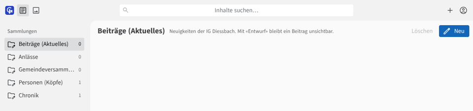
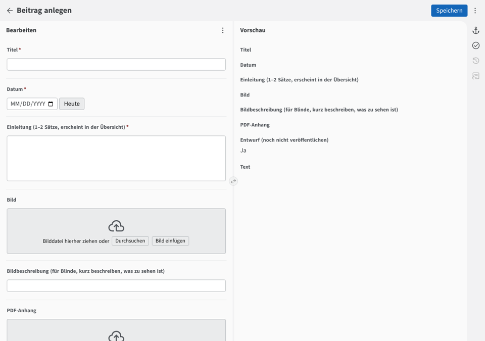
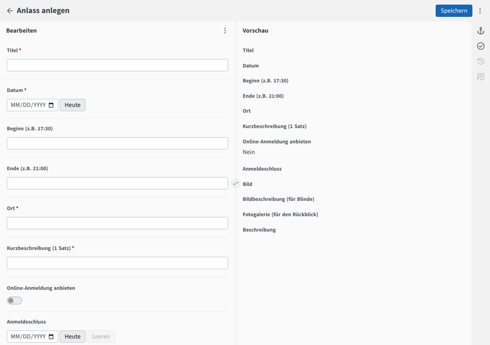
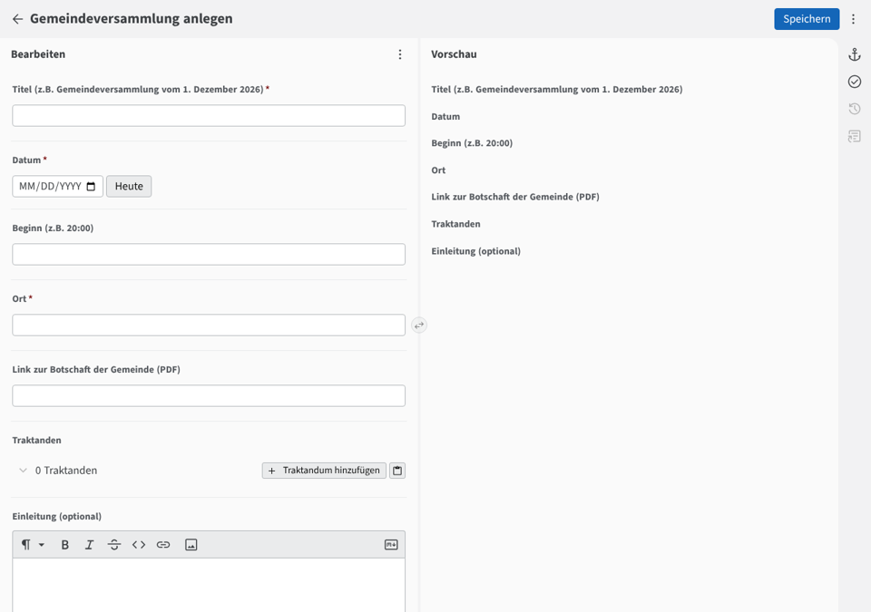

# Kurzanleitung: Website der IG Diessbach pflegen

Für Lorenz, Michaela und Helena. Stand November 2026.

## So melden Sie sich an

1. Öffnen Sie **igdiessbach.netlify.app/admin/** (nach dem Go-live: **igdiessbach.ch/admin/**).
2. Klicken Sie auf **«Mit GitHub anmelden»** und melden Sie sich mit Ihrem GitHub-Konto an.
3. Links sehen Sie die Bereiche, rechts die Einträge:

**Das Wichtigste vorweg:**

- Alles, was Sie **speichern**, ist nach **1–2 Minuten auf der Website**.
- Felder mit **\*** müssen ausgefüllt werden.
- Haben Sie einen Fehler gemacht? Einfach korrigieren und nochmals speichern. Frühere Fassungen bleiben auf GitHub erhalten und lassen sich wiederherstellen.

---

## 1. Beitrag erfassen («Aktuelles»)

1. Klicken Sie links auf **«Beiträge (Aktuelles)»** und oben rechts auf **«Neu»**.
2. Füllen Sie aus:

   - **Titel**: kurz und klar, z.B. «Danke für Ihr Vertrauen»
   - **Datum**: Tag der Veröffentlichung
   - **Einleitung**: 1–2 Sätze. Sie erscheinen in der Übersicht und beim Teilen auf WhatsApp.
   - **Bild** (freiwillig) und eine kurze **Bildbeschreibung**, z.B. «Gruppenfoto vor dem Schulhaus»
   - **Text**: der eigentliche Beitrag. Zwischentitel und Listen sind mit den Knöpfen über dem Textfeld möglich.
3. **Entwurf:** Ein neuer Beitrag ist als Entwurf markiert und noch **nicht sichtbar**. Wenn er fertig ist, schalten Sie «Entwurf» aus.
4. Klicken Sie oben rechts auf **«Speichern»**.

---

## 2. Anlass erfassen

1. Klicken Sie links auf **«Anlässe»** und dann auf **«Neu»**.
2. Füllen Sie aus:

   - **Titel**, **Datum**, **Ort** und eine **Kurzbeschreibung** in einem Satz
   - **Beginn / Ende** im Format **17:30** (freiwillig)
   - **Online-Anmeldung anbieten**: einschalten, wenn sich Leute anmelden sollen. Mit einem **Anmeldeschluss** verschwindet das Formular nach diesem Tag von selbst.
   - **Beschreibung**: Programm, Treffpunkt, was mitzubringen ist
3. **Speichern.**

**Automatisch:** Anmeldungen kommen per E-Mail. Am Tag nach dem Anlass wandert er von selbst in die **«Rückblicke»**. Für den Rückblick öffnen Sie den Anlass danach wieder und laden unter **«Fotogalerie»** Fotos hoch. Ergänzen Sie dazu in der Beschreibung ein paar Sätze, wie es war.

**Bitte beachten:** Laden Sie keine Einladungsflyer mit privaten Telefonnummern hoch.

---

## 3. Gemeindeversammlung mit Empfehlungen

1. Klicken Sie links auf **«Gemeindeversammlungen»** und dann auf **«Neu»** (oder öffnen Sie eine bestehende).
2. Füllen Sie Titel, Datum, Ort und den Link zur Botschaft der Gemeinde aus.
3. Unter **«Traktanden»** klicken Sie pro Geschäft auf **«Traktandum hinzufügen»** und füllen aus:

   - **Worum geht es?** 2–3 Sätze in einfacher Sprache
   - **Was kostet es?** z.B. «Kredit von CHF 250 000»
   - **Unsere Empfehlung:** Ja / Nein / Stimmfreigabe / Kenntnisnahme, dazu eine kurze Begründung
4. **Speichern.** Die nächste Versammlung erscheint automatisch auf der Startseite.

---

## 4. Person ändern (Köpfe)

1. Klicken Sie links auf **«Personen (Köpfe)»** und öffnen Sie **«Alle Personen»**.
2. Klappen Sie die gewünschte Person auf.
3. Häufige Änderungen:

   - **Zitat «Darum engagiere ich mich»**: 1–2 Sätze. Sobald ein Zitat da ist, ersetzt es auf der Website die Anliegen.
   - **Funktionen**: z.B. Ressort im Gemeinderat ergänzen. Mit **«Funktion hinzufügen»** bekommt eine Person eine weitere Funktion.
   - **Porträt**: Klicken Sie auf das Bild, um ein neues hochzuladen. Am besten im Hochformat 4:5 (z.B. 480 × 600 Pixel).
   - **Auf «Köpfe» anzeigen**: ausschalten, wenn jemand nicht mehr aktiv ist. Die Person wird so nicht gelöscht, nur ausgeblendet.
4. **Speichern.**

---

## Hilfe

- Etwas sieht auf der Website falsch aus? Warten Sie 2 Minuten und laden Sie die Seite neu.
- Nach dem Speichern erscheint eine Fehlermeldung? Machen Sie einen Screenshot und schicken Sie ihn an Lorenz.
